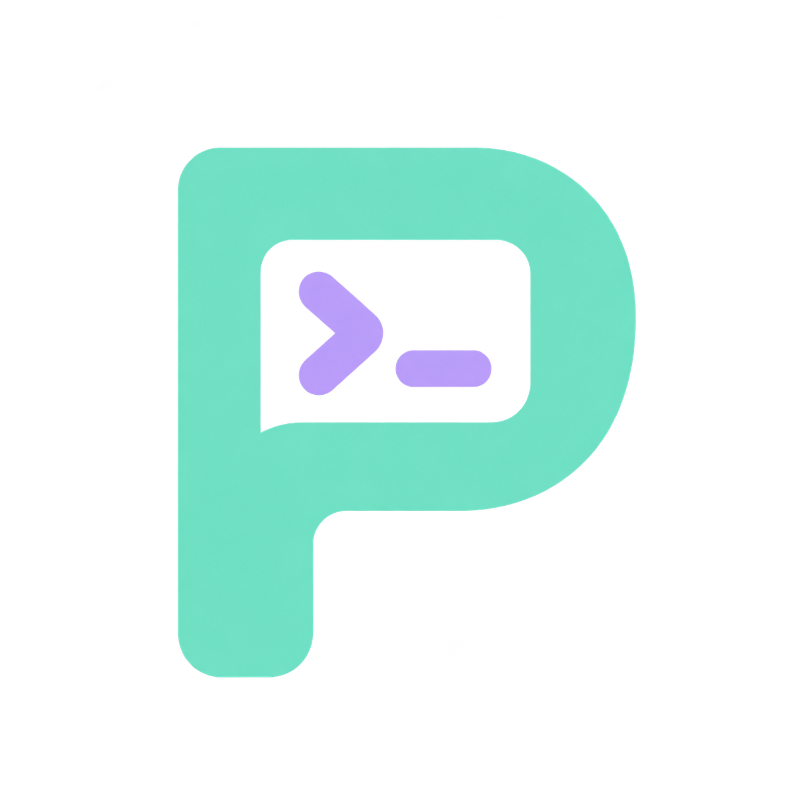
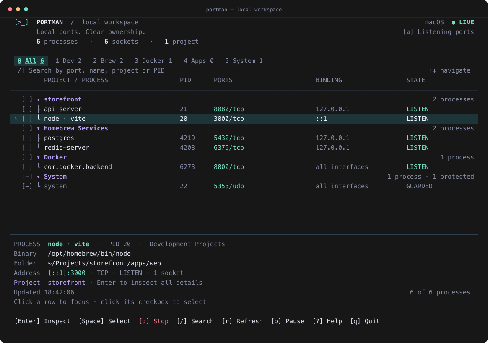

<p align="center">
  
</p>
<h1 align="center">Portman</h1>
<p align="center">Local ports. Clear ownership.</p>

A lightweight terminal workspace for discovering local ports, identifying the
projects behind them, and safely stopping the right processes.

Built with **Go, Bubble Tea and Lip Gloss**. Runs on **macOS and Linux**, with
keyboard and mouse support. No daemon, account, telemetry, or configuration file.
**Precompiled packages do not require Go.**



The preview uses the production renderer with illustrative processes. The
application always shows live data and preserves your terminal's background.

## Supported platforms

| System | Architectures | Runtime requirements |
| --- | --- | --- |
| macOS | Apple Silicon (`arm64`), Intel (`amd64`) | System `libproc` and bundled `/usr/sbin/lsof` |
| Linux | ARM64 (`arm64`), x86-64 (`amd64`) | Mounted `/proc`; Linux 5.3+ and access to pidfd syscalls for termination |

Linux packages are built without cgo and do not require `lsof` or a particular
libc. Linux discovery covers the current network namespace and processes visible
to your user. Restricted processes and ports may be hidden. Windows is not supported.

## Installation

### Precompiled package — no Go required

The portable [installer](install.sh) detects your OS and CPU, verifies the
archive's SHA-256, and installs to `~/.local/bin`. It does not require sudo or
change your shell configuration. Re-running it updates the executable.

**Release status:** this checkout includes packaging and release automation,
but no public repository or release URL has been configured yet. The commands
below work with local packages now; GitHub downloads require a published release.

Download `install.sh`, the archive for your platform, and its matching
`.sha256` file from the same release. Keep the archive and checksum together:

| Platform | Archive |
| --- | --- |
| Mac Apple Silicon | `portman_darwin_arm64.tar.gz` |
| Mac Intel | `portman_darwin_amd64.tar.gz` |
| Linux ARM64 | `portman_linux_arm64.tar.gz` |
| Linux x86-64 | `portman_linux_amd64.tar.gz` |

```sh
# Example for Mac Apple Silicon; choose your archive from the table above.
sh install.sh --archive ./portman_darwin_arm64.tar.gz
export PATH="$HOME/.local/bin:$PATH"
portman
```

Add that PATH line to your shell profile if `~/.local/bin` is not already there.
Use `--prefix /your/path` to install to `/your/path/bin` instead.

Once releases are published, the same installer can download the correct package:

```sh
# Replace OWNER/REPO with the actual GitHub repository containing the releases.
sh install.sh --repo OWNER/REPO
sh install.sh --repo OWNER/REPO --version v0.2.0
```

### From source

Requires **Go 1.24+**. macOS source builds also require Xcode Command Line Tools
(`xcode-select --install`). Linux source builds need no C compiler.

```sh
# From this checkout, on either macOS or Linux:
./install.sh --source
export PATH="$HOME/.local/bin:$PATH"
portman
```

`./install.sh` with no arguments also builds the current checkout. For development,
`make run` builds and launches the TUI without installing it.

### Homebrew on macOS

```sh
make brew-install
portman
```

This creates a local `portman/local` tap from the checkout. Homebrew installs Go
as a build dependency automatically. It is not a published public tap.
Re-run `make brew-install` to update; uninstall with
`brew uninstall portman/local/portman` and `brew untap portman/local`.

For the portable installer, uninstall with `rm "$HOME/.local/bin/portman"`
(or remove it from your custom prefix).

## Using Portman

- **Discover:** listening TCP and bound UDP ports, addresses, PIDs, executable paths,
  working directories, and connection states. Press `a` to include other TCP states.
- **Understand:** group related services by project; distinguish development,
  applications, Homebrew services, Docker host processes, and system processes.
- **Find:** search by port, PID, project, process name, path, protocol, or category.
- **Stop:** review one process, checked processes, or a project's matching members.
  Graceful stop comes first, with a separate confirmation for force stop.
- **Monitor:** automatic refresh keeps the current selection and last successful
  snapshot visible; pause and manual refresh are available.

Use a terminal at least **64 columns × 22 rows**. A binding-address column appears
at 120+ columns. The compact `[>_]` header mark needs no patched font or image protocol.

| Key | Action |
| --- | --- |
| `↑` / `↓`, `j` / `k` | Move between rows |
| `Enter` | Inspect a process; expand or collapse a group |
| `→` / `←` | Expand and enter a group / collapse it |
| `Space` | Check a process or the matching members of a group |
| `d` / `x` | Review checked processes, or the focused row, for termination |
| `/` | Search; `Enter` applies, `Esc` restores the previous search |
| `0`–`5`, `Tab` | Filter categories |
| `a` | Toggle listening ports / all TCP connections |
| `p` / `r` | Pause live updates / refresh now |
| `i` / `?` | Open inspector / help |
| `Esc` | Clear filters and selection; close a dialog |
| `q`, `Ctrl+C` | Quit |

Click a row to focus, a group name to expand, or its checkbox to select. Tabs,
search, footer actions and confirmation buttons accept clicks. Scroll with the
wheel or Page Up / Page Down. Use `--no-mouse` to preserve terminal text selection.

Search combines space-separated terms with AND matching. Selected processes stay
checked across filters; the status line counts hidden selections. Group actions
only affect matching, discovered members. New members are never silently added
to an open confirmation dialog.

## Process discovery and safety

macOS combines native `libproc` metadata with `lsof` socket discovery. Linux reads
`/proc/PID/{stat,status,exe,cwd,fd}` and the current namespace's TCP/UDP tables,
revalidating identities after collecting socket data.

Project detection follows the working directory and up to 12 process ancestors.
Git repositories and worktrees group monorepo services together; otherwise the
nearest manifest defines the project. Recognized files include `package.json`,
`go.mod`, `Cargo.toml`, `pyproject.toml`, `pom.xml`, Gradle files, `Gemfile`,
`composer.json`, `mix.exs`, and `CMakeLists.txt`.

Classification is heuristic. Homebrew categories do not query `brew services`.
Docker entries represent host processes, not individual containers; Portman does
not traverse container namespaces or stop containers through the Docker API.

**Every termination requires confirmation; Enter defaults to Cancel.** Portman
sends SIGTERM, waits two seconds, and offers a separate SIGKILL confirmation only
for survivors. Escalation is never automatic.

PID, start token, executable and ownership are checked before signaling. Root,
other users, critical system processes, and Portman's own terminal ancestry are
protected. Missing identity/path data prevents termination. Signals target only
individual positive PIDs, never entire process groups or arbitrary descendants.

Linux uses pidfds, opening a handle before revalidation to prevent signaling a
recycled PID. If pidfds are unavailable or blocked, termination fails safely;
there is no fallback to an unpinned PID. macOS revalidates immediately before
`kill(2)`, but a small inspection-to-signal race remains. An executable or its
credentials can also change concurrently; no process is frozen during inspection.
Supervisor-managed services may restart after being stopped.

## CLI

```sh
portman --interval 3s       # default 2s, minimum 500ms
portman --all               # include non-listening TCP connections
portman --json              # one real snapshot, then exit
portman --json --all
portman --no-mouse
portman --version
```

Visibility follows OS permissions, macOS SIP and Linux `/proc` restrictions.
Failed scans retain the last good snapshot. Scans have an eight-second timeout
and never overlap. Portman does not request elevation; root-owned processes stay
protected even when it runs as root. JSON includes local paths and process names.

## Development and CI

```sh
make check                 # formatting, vet, race detector, unit + integration tests
make build                 # bin/portman
make package               # native archive + SHA-256 in dist/
make test-install          # binary/source installation and live discovery checks
python3 scripts/smoke-tui.py bin/portman
```

[GitHub Actions](.github/workflows/ci.yml) tests macOS and Linux on both ARM64 and
x86-64: Go checks, real TCP/UDP discovery, guarded termination, package installation,
checksum rejection, reinstall, and keyboard/mouse workflows in a pseudo-terminal.
Tests only terminate disposable processes they create. Installer tests use temporary
prefixes and check that binary installation never invokes Go.

Every successful matrix job uploads its tested archive and checksum. Pushing a
`vX.Y.Z` tag matching [VERSION](VERSION) publishes all four packages and `install.sh`
as a GitHub release **after every test job passes**. No release is published for
ordinary pushes or pull requests. See [architecture and release notes](docs/architecture.md).

The [logo and brand assets](assets/brand/README.md) are included in this repository.
To export a preview from the actual renderer:

```sh
PORTMAN_PREVIEW_DIR=/tmp/portman-preview go test ./internal/tui -run TestExportPreview -count=1
python3 scripts/render-preview.py /tmp/portman-preview/overview.ansi docs/images/overview.svg
```

[MIT license](LICENSE).
